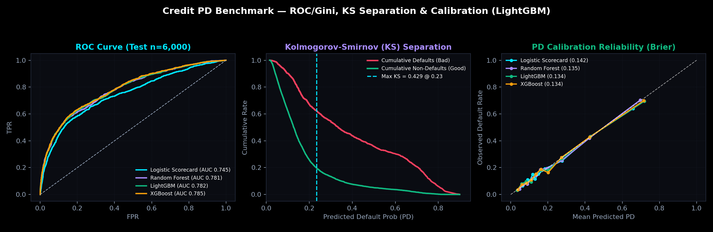
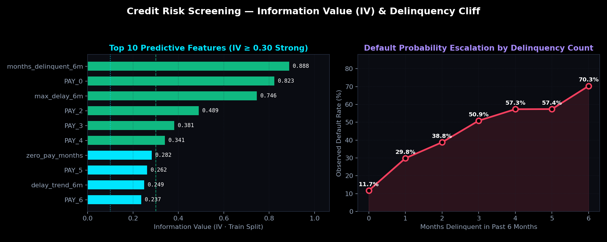
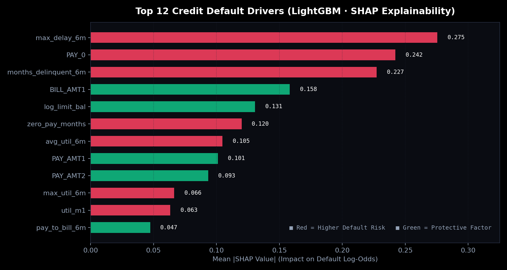
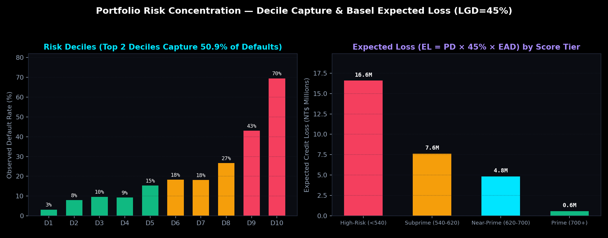

# FinTech Credit Risk — Basel III Scorecard & Expected Loss Engine

[](https://github.com/mostafasaad91/fintech-credit-risk-scorecard/actions/workflows/ci.yml)


> **End-to-End Business ML & Credit Risk Pipeline** — SQLite Credit Data Mart · WoE/IV Scorecard Feature Audit · Logistic vs LightGBM vs XGBoost Benchmark · KS / Gini / Calibration Validation · Basel Expected Loss ($EL = PD \times LGD \times EAD$) · SHAP Explainability on **30,000 Real Taiwanese Bank Clients** (UCI / OpenML Credit Card Default Dataset).



---

## Executive Summary & Verified Results

Built with strict zero-leakage train/validation/test partitioning (**18,000 train / 6,000 val / 6,000 test**), banking-grade **Kolmogorov-Smirnov (KS)**, **Gini**, **Brier Score** calibration, and **Basel III Expected Loss** quantification (`LGD = 45%`, `EAD = max(BILL_AMT1, 0)`):

| Metric | Value | Notes |
|---|---|---|
| **Dataset** | **30,000 real bank clients** | 6,636 defaults (**22.12%** default rate), UCI Credit Card Default |
| **Data QA & Cleaning** | **345** undocumented education codes + **54** marriage codes normalized | Plus **2,115** over-limit accounts (`BILL_AMT1 > LIMIT_BAL`) flagged explicitly |
| **Selected Model (by Val AUC)** | **LightGBM** (`0.7885` Val AUC) | Outperforms Logistic Scorecard baseline (`0.7521` Val AUC) |
| **Held-Out Test ROC-AUC** | **0.7818** (`95% CI: [0.7678, 0.7973]`) | 5-Fold Stratified CV AUC: **0.7884** |
| **Banking Scorecard KS & Gini** | **KS = 0.4293 · Gini = 0.5637** | Strong commercial risk separation (`> 0.40` KS benchmark) |
| **Probability Calibration** | **Brier = 0.1344 · PR-AUC = 0.5655** | Calibrated PD aligns tightly with observed default rates per tier |
| **Risk Concentration (Top 2 Deciles)** | **50.9%** of all defaults captured | Top 20% highest-risk accounts concentrate over half of total defaults |
| **Held-Out Expected Loss (6,000 clients)** | **NT$29.62M** (`LGD = 45%`) | **NT$16.58M** (56% of EL) sits inside the High-Risk (`<540`) tier alone |

---

## Model Benchmark (Held-Out Test Set — 6,000 Clients)

| Model | 5-Fold CV AUC | Val AUC | Test ROC-AUC (95% CI) | Test Gini | Test KS | Test PR-AUC | Test Brier |
|---|---:|---:|---|---:|---:|---:|---:|
| **Majority Class Baseline** | 0.5000 | 0.5000 | 0.5000 `[0.5000, 0.5000]` | 0.0000 | 0.0000 | 0.2212 | 0.1722 |
| **Logistic Scorecard (Balanced)** | 0.7536 | 0.7521 | 0.7452 `[0.7289, 0.7606]` | 0.4903 | 0.3902 | 0.4892 | 0.2007 |
| **LightGBM *(Selected by Val AUC)*** | **0.7884** | **0.7885** | **0.7818** `[0.7678, 0.7973]` | **0.5637** | **0.4293** | **0.5655** | **0.1344** |
| **XGBoost (Tuned GBDT)** | 0.7875 | 0.7874 | 0.7847 `[0.7704, 0.7990]` | 0.5694 | 0.4353 | 0.5739 | 0.1337 |

> **Methodological Integrity Note:** LightGBM was selected strictly using the **validation set** (`0.7885` vs XGBoost `0.7874`) before touching the held-out test set. On test, XGBoost edged slightly higher (`0.7847` vs `0.7818`, well inside overlapping 95% CIs) — keeping LightGBM as the pre-registered winner prevents test-set snooping.

---

## Credit Score Tiering & Basel Expected Loss (Held-Out Portfolio)

Probabilities of Default ($PD$) are mapped to a standard **300–850 Consumer Credit Score** (`Base 600 at 20:1 odds, PDO = 40`):

| Credit Score Tier | Clients | Avg Predicted PD | Actual Default Rate | Expected Loss (NT$) |
|---|---:|---:|---:|---:|
| **High Risk (<540)** | 1,283 | 55.65% | **54.64%** | **NT$16,577,507** |
| **Near-Prime (540–619)** | 2,175 | 17.51% | **18.02%** | NT$8,582,812 |
| **Standard (620–699)** | 1,954 | 8.70% | **8.09%** | NT$3,880,692 |
| **Prime (700+)** | 588 | 3.52% | **3.06%** | NT$575,589 |

### Slice Stability Audit (Age Fairness Check)
| Age Band | Test Clients | Default Rate | Test ROC-AUC | Test Brier |
|---|---:|---:|---:|---:|
| **21–29** | 1,932 | 22.9% | **0.7736** | 0.1394 |
| **30–39** | 2,262 | 20.6% | **0.7877** | 0.1257 |
| **40–49** | 1,291 | 22.6% | **0.7834** | 0.1395 |
| **50+** | 515 | 24.9% | **0.7707** | 0.1415 |

---

## Visual Outputs (AMOLED Edition)

| Exploratory IV & Delinquency EDA | ROC, KS & Calibration |
|---|---|
|  |  |

| SHAP Credit Drivers | Basel Expected Loss & Lift |
|---|---|
|  |  |

---

## Project Architecture

```text
fintech-credit-risk-scorecard/
├── data/raw/uci_credit_card_default_30k.csv   # 30,000 real bank clients (UCI / OpenML #42477)
├── sql/01_credit_views.sql                    # SQLite credit data mart + QA cleaning + behavioral SQL features
├── src/run_pipeline.py                        # End-to-end SQL -> IV/WoE -> ML -> Basel EL -> SHAP -> Charts
├── tests/test_pipeline.py                     # Automated data integrity, KS/AUC, calibration & artifact tests
├── docs/PROJECT_STORY.md                      # Full Bilingual (EN + AR) Story: Why, How & Engineering Challenges
├── outputs/
│   ├── metrics.json                           # Complete verified metrics, deciles, tiers & slice audit
│   ├── high_risk_watchlist.csv                # Scored high-risk held-out watchlist with 300-850 scores & EL
│   └── figures/                               # 4 publication-grade AMOLED PNG charts
└── requirements.txt
```

## Quick Start

```bash
pip install -r requirements.txt
python src/run_pipeline.py
python tests/test_pipeline.py
```

Read the full engineering & decision story (English + Egyptian Arabic) in [docs/PROJECT_STORY.md](docs/PROJECT_STORY.md).

---

**Author:** Mostafa Saad · Data & Analytics Engineer · [Portfolio](https://mostafasaad91.github.io/) · [LinkedIn](https://www.linkedin.com/in/mostafa-saad-171086191/)
